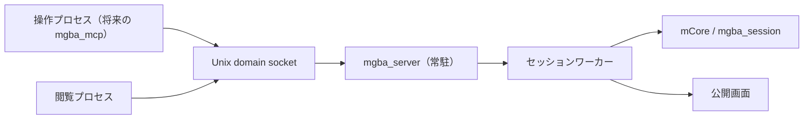
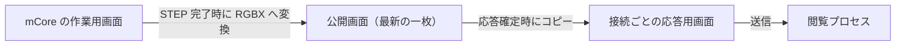

# エミュレータセッションを常駐サーバにする

## 1. 目的と対象範囲

[issue #1「エミュレータ動作中の画面を閲覧したい」](https://github.com/Enchan1207/mgba_mcp/issues/1) に向け、操作プロセスと閲覧プロセスが一つのエミュレータセッションを共有する常駐サーバを作る。

この issue の成果物は、`mgba_server` の常駐実行形式、通信プロトコル、プロトコルを検証するテストとする。既存の `mgba_server_cli` はコマンドファイルを処理する実行形式として維持する。閲覧 UI は後続の作業で設計する。

対象とする環境は同一ホスト上のプロセス間通信と、現在の `mgba_session` が扱う Game Boy の 160 × 144 ピクセル画面とする。エミュレーションは `STEP` の要求に応じて進める。

## 2. 全体構成とライフサイクル



| 構成要素 | 責務 |
| --- | --- |
| 接続処理 | クライアントの受け付け、役割判定、要求・応答、ロギング |
| セッションワーカー | `mCore` の操作と画面状態の公開 |
| 公開画面 | 最新の画像、経過フレーム数、画面更新番号の保持 |
| 接続ごとの状態 | 役割、最後に通知した更新番号、応答用バッファの保持 |

サーバの起動形式は `mgba_server --rom <ROM_PATH> --socket <SOCKET_PATH>` とする。ROM を読み込んでセッションを初期化し、Unix domain socket を作成して接続を受け付ける。ソケットファイルには所有者の読み書き権限を設定する。指定パスに既存のファイルがある場合は起動エラーを記録して終了する。

`CONTROL` 接続は同時に一つ、`VIEW` 接続は複数受け付ける。`CONTROL` 接続の切断時にはセッションを保持し、次の `CONTROL` 接続を受け付ける。終了時にはソケットファイルを片付ける。

## 3. 外部インターフェース

### 3.1 接続と要求

クライアントは接続後の最初の要求で `HELLO CONTROL\n` または `HELLO VIEW\n` を送る。サーバは通常の応答形式で結果を返す。`CONTROL` 枠が使用中の場合は `CONTROL_BUSY`、役割宣言の構文が不正な場合は `BAD_REQUEST` を返して接続を閉じる。役割判定後にコマンドを受け付ける。

要求は UTF-8 の一行を `\n` で終える。コマンド名と引数は ASCII で記述し、英字の大文字・小文字を同等に扱う。要求行の上限は終端の `\n` を含めて 32 バイトとし、上限を超えた接続は閉じる。同じ接続では一度に一要求を処理し、各要求に応答を一つ返す。

### 3.2 コマンド

| コマンド | 接続の役割 | 動作 |
| --- | --- | --- |
| `PRESS <button>` | `CONTROL` | ボタンを押下状態にする |
| `RELEASE <button>` / `RELEASE ALL` | `CONTROL` | ボタンの押下状態を解除する |
| `STEP <frames>` | `CONTROL` | 1～18000 フレーム進め、最終画面を公開する |
| `RESET` | `CONTROL` | 入力・経過フレーム数・公開画面を初期状態へ戻す |
| `STATUS` | `CONTROL`, `VIEW` | 現在のセッション状態を返す |
| `CAPTURE` | `CONTROL`, `VIEW` | 現在の公開画面を直ちに返す |
| `WAIT_FRAME <timeout_ms>` | `VIEW` | 指定時間（1～60000 ミリ秒）まで画面状態の更新を待つ |
| `QUIT` | `CONTROL` | 成功応答を返して終了処理を始める |

`button` は `A`, `B`, `SELECT`, `START`, `RIGHT`, `LEFT`, `UP`, `DOWN` を受け付ける。`RELEASE` は `ALL` も受け付ける。`timeout_ms` と `frames` は十進整数とする。

### 3.3 応答形式

応答は次の順に送る。本文長の上限は 1 MiB とする。

```text
[結果: ASCII の S または E (1バイト)]
[本文長: uint32_t、リトルエンディアン (4バイト)]
[本文: 指定されたバイト数]
[EOP: \n (1バイト)]
```

`S` は成功、`E` はエラーを表す。エラー本文には ASCII のエラーコードを一つ入れ、本文全体を正規表現 `^[A-Z_]+[A-Z]$` に一致させる。本文長 0 の成功応答は `S\0\0\0\0\n` となる。

`HELLO`、`PRESS`、`RELEASE`、`STEP`、`RESET`、`QUIT` の成功応答は本文長 0 とする。`STATUS` の成功本文は ASCII の `frames=<uint64> pressed_keys=<uint32> has_frame=<true|false>` とし、`has_frame` の値で本文を終える。`pressed_keys` は既存のセッション状態が保持する入力ビットマスクを十進数で表す。

`CAPTURE` と `WAIT_FRAME` の成功本文は次の形式とする。

```text
[経過フレーム数: uint64_t、リトルエンディアン (8バイト)]
[幅: uint8_t (1バイト)]
[高さ: uint8_t (1バイト)]
[画素バイト列: RGBX8888、幅 × 高さ × 4 バイト]
```

画素は `R, G, B, X` の順に並べ、`X` は 0 とする。現在の幅 160・高さ 144 では、画素バイト列は 92,160 バイト、画像本文は 92,170 バイトとなる。経過フレーム数は `mgba_session.frames_elapsed` と同じ `uint64_t` で送る。受信側は本文長と寸法の整合性を検証し、必要に応じて PNG へ変換する。

| エラーコード | 発生条件 | 接続 |
| --- | --- | --- |
| `BAD_REQUEST` | 要求の構文・引数・役割宣言が不正 | コマンドでは継続、役割宣言では終了 |
| `FORBIDDEN` | 接続の役割がコマンドを許可しない | 継続 |
| `CONTROL_BUSY` | `CONTROL` 枠が使用中 | 終了 |
| `NO_FRAME` | `CAPTURE` または `WAIT_FRAME` が画像なしの状態を取得 | 継続 |
| `TIMEOUT` | `WAIT_FRAME` の待機時間が経過 | 継続 |
| `SERVER_SHUTDOWN` | 正常終了中の `WAIT_FRAME` | 終了 |
| `INTERNAL_ERROR` | 応答作成前にサーバ内部の処理が失敗 | 終了 |

受信側はヘッダーの 5 バイト、指定長の本文、EOP の 1 バイトを順に読み切り、EOP が `\n` であることを検証する。本文長と経過フレーム数はバイト配列からリトルエンディアンとして組み立てる。長さの上限と EOP の検証失敗時には接続を閉じる。

## 4. セッションの動作

| 状態 | 起動時 | 更新 |
| --- | --- | --- |
| 押下中のボタン | 0 | `PRESS`、`RELEASE`、`RESET` |
| 経過フレーム数 | 0 | `STEP` で加算、`RESET` で 0 |
| 公開画面 | 画像なし | `STEP` で最終フレーム、`RESET` で画像なし |
| 画面更新番号 | 0 | `STEP` 完了時と `RESET` 時に 1 加算 |

画面更新番号はサーバ内部の `uint64_t` とし、各閲覧接続は最後に通知した番号を一つ保持する。`PRESS` と `RELEASE` は入力状態を更新する。`STEP` は指定フレーム数の実行後に最終画面と経過フレーム数を公開し、その後で成功応答を返す。連続する更新の間もサーバは公開画面として最新の一枚を保持する。

`CAPTURE` は応答確定時点の公開状態を取得し、その接続の通知済み番号を更新する。起動直後と `RESET` 直後は `NO_FRAME` を返す。`STATUS` は押下中のボタン、経過フレーム数、画面の有無を同じ時点の状態から返す。

閲覧接続の通知済み番号が未設定の場合、`WAIT_FRAME` は現在の公開状態を直ちに返す。`CAPTURE` または `WAIT_FRAME` によって番号が設定された後は、次の `WAIT_FRAME` が画面更新番号の変化を待つ。画像の更新時には画像本文、`RESET` 時には `NO_FRAME` を返す。`NO_FRAME` でも通知済み番号を更新し、閲覧側は表示をクリアする。待機時間が経過した場合は `TIMEOUT` を返し、通知済み番号を維持する。再接続した閲覧プロセスは現在の公開状態から取得を始める。

## 5. 画面データと並行処理



一つのセッションワーカーが `mCore` を操作する。接続処理は操作コマンドをワーカーへ渡し、閲覧要求を公開状態から処理する。`STEP` 完了時には、作業用画面の RGBX 変換結果、経過フレーム数、画面更新番号を同じロックの下で公開してから、待機中の閲覧接続へ通知する。`PRESS` と `RELEASE` の入力状態も同じロックの下で公開する。

`CAPTURE` と `WAIT_FRAME` の応答確定時には、同じロックの下で公開画面とメタデータを接続ごとの応答用バッファへコピーし、通知済み番号を記録する。ロックを解放してから送信し、送信完了または切断時に応答用バッファを解放する。送信中に `STEP` が進むと、公開画面に新しい画像、応答用バッファに送信中の画像が一時的に並ぶ。次の `WAIT_FRAME` はその時点の最新画像を取得する。

`RESET` は同じロックの下で画像なしの状態を公開する。`RESET` より前に確定した応答は確定時の画像を送信し、公開後に確定した応答は `NO_FRAME` を返す。`WAIT_FRAME` は単調時計で待機時間を測る。

## 6. ロギングと障害時の扱い

サーバは標準エラー出力へ、UTC のタイムスタンプ、ログレベル、イベント名を付けた一行ログを出す。接続受理時にサーバ内で一意の `client_id` を割り当て、コマンドごとに接続内の連番 `request_id` を付ける。通常の操作は `INFO`、要求や通信の失敗は `WARN`、起動・ROM 読込・ソケット準備の失敗は `ERROR` とする。複数の接続処理からの出力は一行単位で直列化する。

| イベント | 記録内容 |
| --- | --- |
| サーバ起動・終了 | ROM パス、ソケットパス、終了理由 |
| クライアント接続・切断 | `client_id`、接続タイプ、切断理由 |
| コマンド受理 | `client_id`、`request_id`、パース済みのコマンドと引数 |
| 応答返送 | `client_id`、`request_id`、`S` / `E`、本文長、本文の概要、処理時間 |
| 画面状態の更新 | `STEP` / `RESET`、画面更新番号、経過フレーム数 |
| 接続・要求・通信の失敗 | `client_id`、失敗した処理、エラーコードまたは OS エラー |

接続ログは役割判定後に記録する。応答返送は EOP まで送信できた時点で記録する。エラー本文は ASCII のエラーコード、画像本文は `(binary)` と本文長・経過フレーム数・寸法を記録する。コマンドやパスを含む文字列フィールドは制御文字をエスケープして一行に収める。送信失敗は通信失敗のイベントとして記録する。

`QUIT` には本文長 0 の成功応答を返す。サーバは新規接続を停止し、受理済みの操作を完了し、待機中の `WAIT_FRAME` に `SERVER_SHUTDOWN` を返す。続いて接続とソケットファイルを片付ける。`SIGINT` と `SIGTERM` も同じ終了処理を開始する。クライアントは応答途中の EOF を切断として扱う。

## 7. 検証方針

CMake の GoogleTest と CTest で、次の動作を検証する。

- 役割宣言、`CONTROL` の占有、接続の切断・再接続を検証する。
- コマンドの権限、引数、`STATUS` 本文、エラーコードを検証する。
- `STEP`、`CAPTURE`、`WAIT_FRAME`、`RESET` による画像と `NO_FRAME` の遷移を検証する。
- `WAIT_FRAME` のタイムアウトと正常終了時の `SERVER_SHUTDOWN` を検証する。
- `STEP` と画面送信を並行させ、画像とメタデータの整合性を検証する。
- 分割されたソケット入出力、32 バイトの要求行、本文長、EOP の検証を行う。
- 接続・コマンド・応答・切断のログを `client_id` と `request_id` で追跡し、画像本文を `(binary)` として記録することを確認する。
