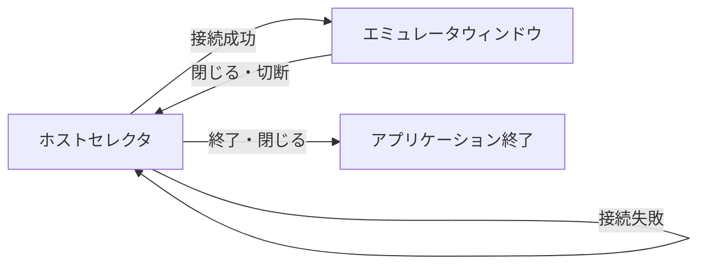

# エミュレータのビューアクライアントを作る

## 1. 目的と対象範囲

[issue #2「エミュレータビューアクライアントの実装」](https://github.com/Enchan1207/mgba_mcp/issues/2) に向け、`mgba_server` の公開画面と動作状態を閲覧する GUI クライアントを作る。同一ホスト上の指定された Unix domain socket に接続し、閲覧専用の `VIEW` 接続を使う。エミュレータの操作は行わない。

## 2. ユーザーインターフェース

### 起動と画面遷移

- 起動するとホストセレクタを表示する。ソケットパスはここで入力する。ROM は指定しない。
- 「接続」を押すと指定ソケットへ接続し、`HELLO VIEW` を送る。成功したらホストセレクタを隠してエミュレータウィンドウを表示する。接続失敗時は理由を表示し、ホストセレクタに留まる。
- エミュレータウィンドウを閉じると接続を閉じ、ホストセレクタを再表示する。予期しない切断・プロトコル異常ではダイアログで理由を伝え、エミュレータウィンドウを閉じてホストセレクタに戻る。
- ホストセレクタの「終了」ボタンまたはウィンドウを閉じる操作でアプリケーションを終了する。サーバの終了コマンドは送らない。

### 画面

| 領域 | 表示内容 |
| --- | --- |
| ホストセレクタ | Unix domain socket のパス入力欄、「接続」「終了」ボタン |
| エミュレータウィンドウ：画面画像 | 受信した最新フレームを縦横比を保って表示する。初回フレーム前と `RESET` 後は空表示にする |
| エミュレータウィンドウ：動作状態 | 経過フレーム数、押下中のボタン、画面画像の有無を表示する |
| エミュレータウィンドウ：接続状態 | 接続中・待機中を表示する |

画像はサーバから届く RGBX8888 の画素列を GUI の画像オブジェクトに変換して表示する。PNG ファイルへの保存機能は対象に含めない。

### 更新

- `WAIT_FRAME` で画面状態の更新を待ち、画像を受け取ったら表示を更新する。`NO_FRAME` は画像を消す。`TIMEOUT` は接続を維持して再度待つ。
- 更新を受けた時点で `STATUS` を取得し、動作状態を更新する。画像と `STATUS` は別々の時点で確定することを許容する。画面の待機・受信は GUI の操作を止めない形で処理する。
- ビューアから `PRESS`、`RELEASE`、`STEP`、`RESET`、`QUIT` は送らない。

## 3. 残る検討事項

- 実装に使う GUI フレームワークと、各画面の具体的な配置・サイズ。
