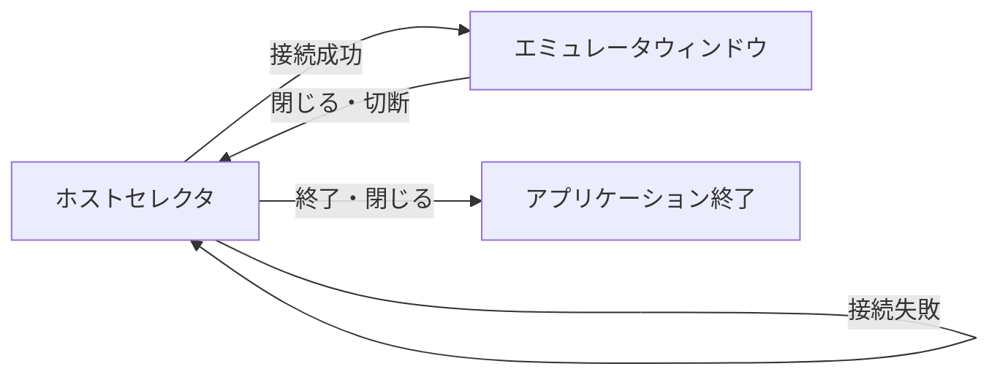

# エミュレータビューアクライアントの設計

## 1. 目的と対象範囲

[issue #2「エミュレータビューアクライアントの実装」](https://github.com/Enchan1207/mgba_mcp/issues/2) に向け、`mgba_server` の公開画面と動作状態を閲覧する macOS 向け GUI クライアントを作る。同一ホスト上の指定された Unix domain socket に接続し、閲覧専用の `VIEW` 接続を使う。エミュレータの操作は行わない。

GUI は Swift から AppKit を使って構築する。

## 2. ユーザーインターフェース

### 起動と画面遷移

- 起動するとホストセレクタを表示する。ソケットパスはここで入力する。
- 「接続」を押したときに入力値を検証し、正しければ指定ソケットへ接続して `HELLO VIEW` を送る。成功したらホストセレクタを隠してエミュレータウィンドウを表示する。入力エラーや接続失敗時は理由を表示し、ホストセレクタに留まる。入力済みのソケットパスは戻ったときにも保持する。
- エミュレータウィンドウを閉じると接続を閉じ、ホストセレクタを再表示する。予期しない切断・プロトコル異常ではダイアログで理由を伝え、エミュレータウィンドウを閉じてホストセレクタに戻る。
- ホストセレクタの「終了」ボタンまたはウィンドウを閉じる操作でアプリケーションを終了する。

### 画面

| 領域 | 表示内容 |
| --- | --- |
| ホストセレクタ | Unix domain socket のパス入力欄、待機時間のテキストフィールド、「接続」「終了」ボタン |
| エミュレータウィンドウ：画面画像 | 受信した最新フレームを縦横比を保って表示する。初回フレーム前と `RESET` 後は空表示にする |
| エミュレータウィンドウ：動作状態 | 経過フレーム数、押下中のボタン、画面画像の有無を表示する |
| エミュレータウィンドウ：接続状態 | 接続中・待機中を表示する |

画像はサーバから届く RGBX8888 の画素列を `NSImage` に変換し、`NSImageView` に表示する。状態表示には `NSTextField`、接続操作には `NSTextField` と `NSButton`、エラー通知には `NSAlert` を使う。画像の拡大時も縦横比を保つ。

画面は Auto Layout で配置する。エミュレータウィンドウの内容領域は初期サイズを 640 × 640 ポイント、最小幅を 480 ポイントとし、リサイズ中も 1:1 に保つ。上部の画像領域は Game Boy 画面の 160 × 144 ピクセルを 4 倍にした 640 × 576 ポイントで始め、幅と高さを 10:9 に保つ。画像はこの領域全体に表示し、上下左右に余白を作らない。下部の状態領域は初期高さを 64 ポイントとし、ウィンドウ幅に応じて高さを変える。二つの領域で内容領域を隙間なく埋める。タイトルバーを含むウィンドウ外枠の縦横比は制約しない。ホストセレクタの初期幅は約 640 ポイント、高さは入力欄・ボタン・余白が収まる分だけとし、横方向のみリサイズ可能にする。

### 更新

- `WAIT_FRAME` で画面状態の更新を待ち、画像を受け取ったら表示を更新する。`NO_FRAME` は画像を消す。`TIMEOUT` は接続を維持して再度待つ。初回の `WAIT_FRAME` では、その時点の公開状態を取得する。
- ホストセレクタで待機時間を秒単位のテキストとして入力する。初期値は `60`、有効な値は 10～120 の整数とし、「接続」を押したときに検証する。ソケットパスの空欄も同じタイミングで検証する。検証済みの待機時間を `WAIT_FRAME` に指定する。`TIMEOUT` は切断やエラーとして表示せず、次の待機を始める。
- 更新を受けた時点で `STATUS` を取得し、動作状態を更新する。画像と `STATUS` は別々の時点で確定することを許容する。表示する状態は `STATUS` の取得時点の値とし、画像本文の経過フレーム数と一致しない場合も許容する。
- ビューアから `PRESS`、`RELEASE`、`STEP`、`RESET`、`QUIT` は送らない。
- 画面更新の待機中も、ウィンドウを操作して閉じられるようにする。

## 3. アプリケーションの構成

| コンポーネント | 行う操作 |
| --- | --- |
| 通信クライアント | 指定ソケットへの `VIEW` 接続、`WAIT_FRAME` と `STATUS` の送受信、応答の解析、切断 |
| 画面制御 | 接続操作を通信クライアントへ渡し、受信結果・エラーに応じて画面を更新・遷移させる |
| ホストセレクタ | ソケットパスと待機時間を受け取り、接続・終了操作を画面制御へ伝える |
| エミュレータウィンドウ | 画像・動作状態・接続状態を表示し、閉じる操作を画面制御へ伝える |

通信クライアントは AppKit に依存せず、受信した画像と状態を画面制御へ渡す。通信形式は [セッションサーバ設計](261110_%231_セッションサーバ設計.md) に従う。

## 4. サーバ側の変更

ビューアで指定できる待機時間の上限に合わせ、`mgba_server` の `WAIT_FRAME <timeout_ms>` の許容範囲を 1～120000 ミリ秒に拡張する。待機時間以外の応答形式と動作は維持する。
